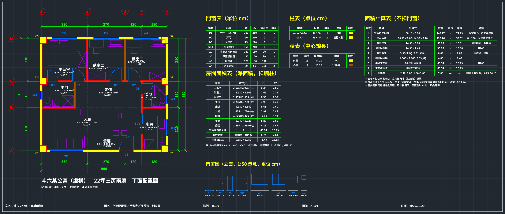

# autocad-ai：用程式畫 CAD 平面圖

不開 AutoCAD，用 Python（ezdxf）直接寫出 AutoCAD 打得開的 DXF。樣本是虛構的「斗六 22 坪三房兩廳」：分圖層、門窗是圖塊、有尺寸標註、房名和面積，再加門窗表、柱表、牆表、門窗立面和裝修算量表（粉刷、油漆、地磚、天花板）。



## 檔案
- `dl22_plan.dxf`：成品，單位 cm
- `plan_color.png`：深色底彩色版（模仿 AutoCAD 畫面）
- `plan.png`、`plan.pdf`：白底黑線出圖
- `make_plan.py`：產生 DXF，改上面的軸線、牆、門窗、房間就能換格局
- `verify.py`：讀回 DXF 核對門窗數量、面積加總、算量表；`verify_log.txt` 是跑的結果
- `render.py`：出 PNG / PDF
- `dl22_walls.lsp`：AutoLISP 最小版（建圖層、軸線、牆中心線，還沒在真的 AutoCAD 測）
- `PROMPT.md`：交給 AI 時的需求模板
- `HANDOFF.md`、`RESEARCH.md`：接案筆記、查到的資料（裡面提到的對照圖沒有放上來，因為含原片畫面）

## 怎麼跑
```bash
python3 -m venv .venv && .venv/bin/pip install ezdxf shapely matplotlib pillow
.venv/bin/python make_plan.py
.venv/bin/python verify.py dl22_plan.dxf
.venv/bin/python render.py dl22_plan.dxf plan.png
.venv/bin/python render.py dl22_plan.dxf plan_color.png --dark
```

只是示意／代繪，不是簽證圖。
