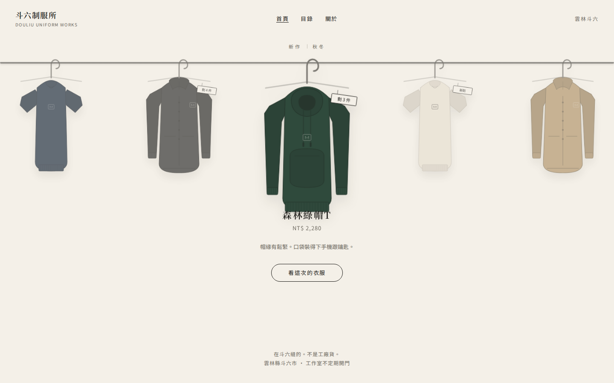
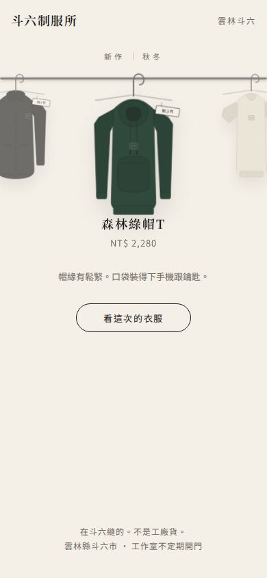
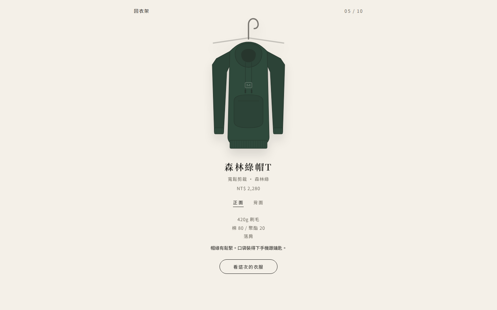

# clothing-rack：衣架拖曳商品輪播

虛構品牌「斗六制服所」。衣服掛在一排衣架上，左右拖有慣性，放手會自動對齊，中間那件放大，品名和價格跟著換；點進去是細節頁，可以翻正反面。

https://github.com/Miiduoa/skill-samples/raw/main/clothing-rack/demo.mp4

| 桌機 | 手機 | 細節頁 |
|---|---|---|
|  |  |  |

## 說明
- 這是第一版，10 件衣服是自己畫的 SVG，看起來偏插畫。換成寫實商品照的第二版還在做。
- 前端是 React + Vite，另有一個 Shopify 布景主題用的 `sections/clothing-rack.liquid`。那份原始碼在雲端開發環境，這裡先只放成品錄影和截圖，整理好再補上。
- 還沒在真的 Shopify 商店裝過。
