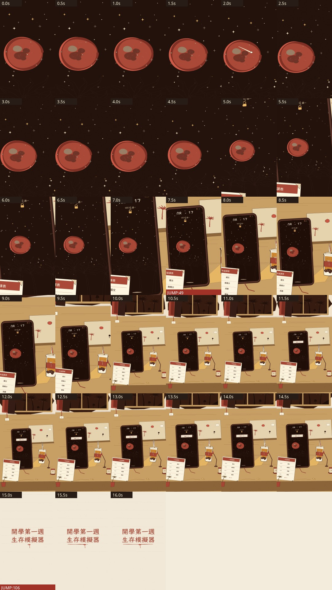

# code-animation：用程式逐格畫短動畫

不用 AI 生圖，每一格都是 Python（Pillow）照時間算出來畫的，最後用 ffmpeg 接成 1080×1920 直式影片。做了兩支，各有 v1 和 v2：

- `campus_reveal_*`：宿舍書桌、課表、手機通知，最後拉出「開學第一週生存模擬器」字卡
- `drink_ad_*`：手搖飲「新生杯」廣告

`contact_sheet*.jpg` 是把整支片每隔一段抽一格排成一張，用來自己檢查畫面。

## 怎麼做的
流程參考 [ClaudeAnimationBase](https://github.com/JohnHeibel/ClaudeAnimationBase)（MIT）：分鏡 → 每格用「時間的純函數」畫 → 抽格自檢 → ffmpeg。繪圖程式是另外寫的，沒有複製它的原始碼。細節看 `NOTES.md`，來源和授權看 `sources.md`。

產生影片的 Python 原始碼在雲端開發環境，這裡先放成品，整理好再補。

## 還差的
棕櫚葉還是多邊形、手機通知看起來假、標題字偏細。全片無聲。
