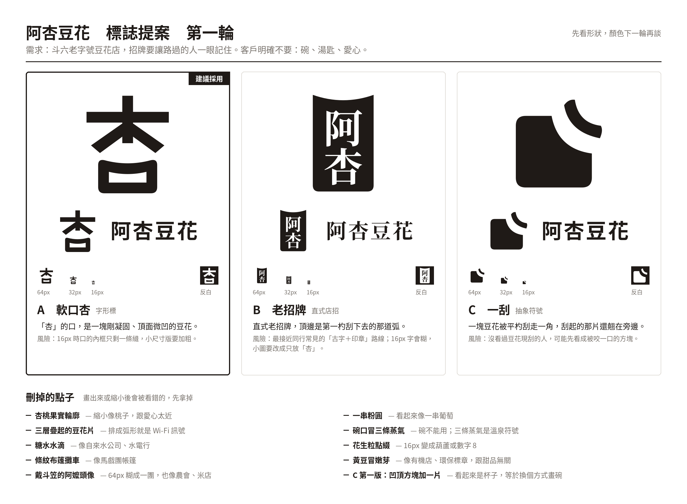

# logo-design：小店 logo 三方向提案

虛構客戶「阿杏豆花」，做了三個方向：A 軟口、B 老招牌、C 一刮。每個都有單圖和橫式組合，SVG＋PNG，最後拼成一張給客戶挑的提案圖。



## 檔案
- `sample/*.svg`、`sample/*.png`：三個方向的成品
- `sample/proposal.png`：提案圖（2400×1760）
- `sample/CONCEPTS.md`：每個方向的想法、刪掉了哪些點子和原因
- `sample/gen.py`：產生 SVG（字用 Noto CJK 轉成外框路徑）
- `sample/proposal.py`：拼提案圖
- `HANDOFF.md`：誰會買、建議價格和來源、照做步驟

## 怎麼跑
```bash
pip install fonttools cairosvg pillow
sudo apt-get install -y fonts-noto-cjk   # gen.py 讀 /usr/share/fonts/opentype/noto/ 底下的字
cd sample && python3 gen.py && python3 proposal.py
```

## 還差的
都還是黑白稿；B 縮到 16px 會糊；沒有實物 mockup。
