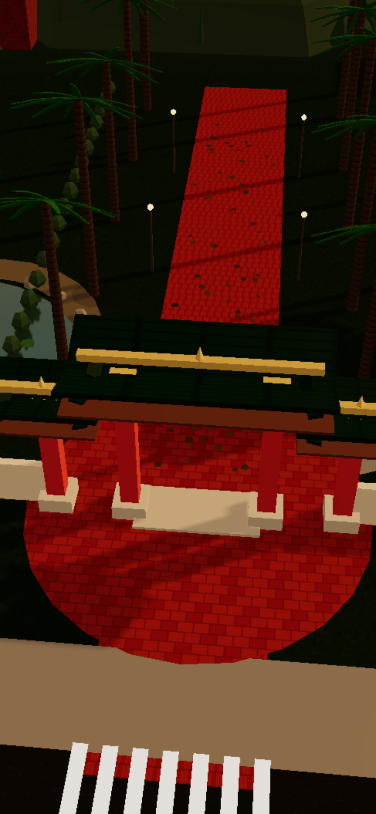
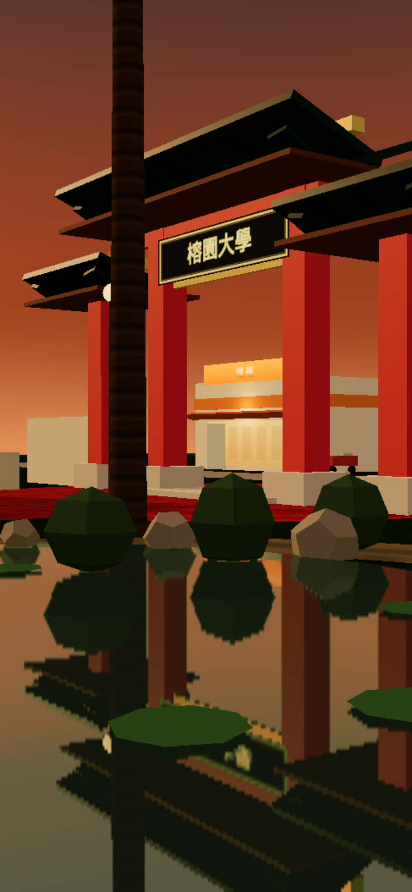
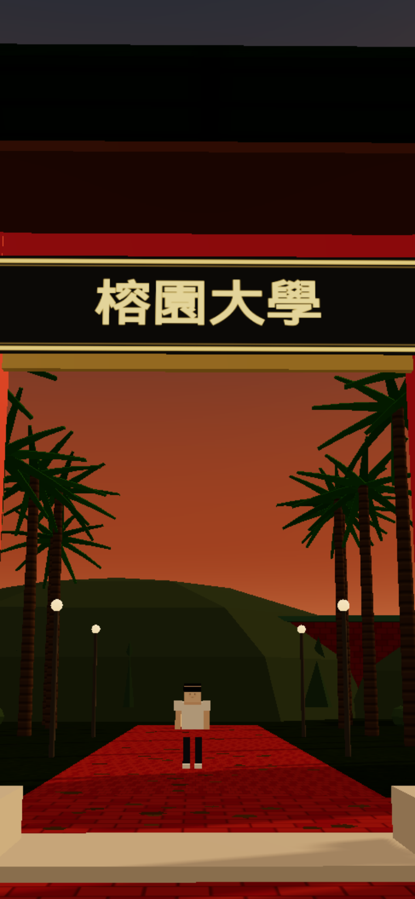
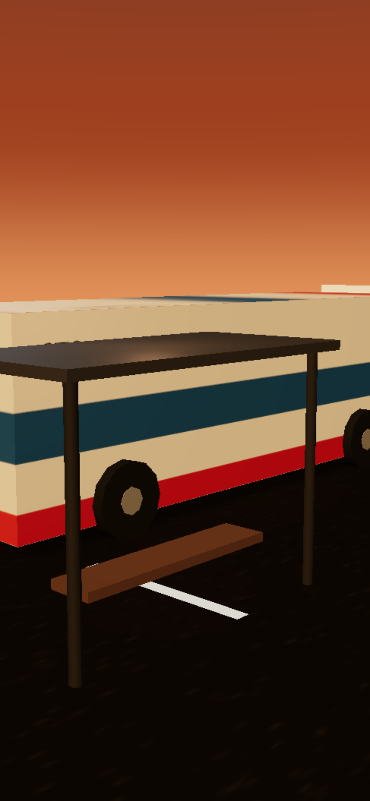

# threejs-scene：可走動的 3D 校門口

虛構的「榕園大學」校門口傍晚：牌樓、大王椰子、榕樹、紅磚步道、公車站、便利商店、有倒影的小池塘。用 three.js 在瀏覽器即時畫，不載入外部模型或貼圖，材質全部用 Canvas 畫。

https://github.com/Miiduoa/skill-samples/raw/main/threejs-scene/media/walkthrough.mp4

| 空拍 | 池塘 | 校門 | 公車站 |
|---|---|---|---|
|  |  |  |  |

## 怎麼跑
```bash
npm install
npm run dev        # 打開 http://127.0.0.1:4876
```
電腦用 WASD 或方向鍵走，滑鼠拖曳轉鏡頭；手機用左下搖桿。右上「空拍環繞」切空拍。網址加 `?demo=1` 會自己播一段。

錄影：`npm run build && npm run preview &`，再 `npm run capture`（要有 Chrome / Playwright）。

做法、prompt 寫法、行數和時間記在 `NOTES.md`。

## 還差的
這是第一版，水面和光線還很平，跟真實感差很多。換成真實水面反射、HDRI 環境光和材質貼圖的第二版正在做。

字型 `public/fonts/wqy-microhei.ttc` 是文泉驛微米黑（Apache 2.0 / GPL-3.0 含字型嵌入例外）。
