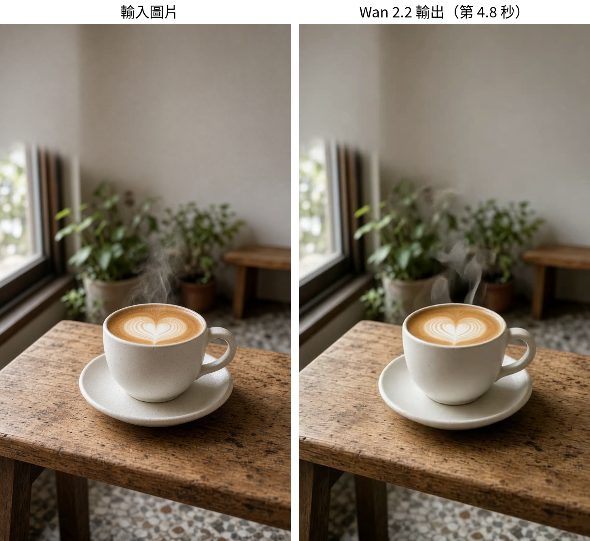

# wan-i2v：一張照片變 5 秒動態短片

輸入一張咖啡照（AI 生成、沒有品牌），用開源的 Wan 2.2 圖轉影片做出蒸氣冒出來、鏡頭慢慢推近的 5 秒片，再補幀、放大成 1080×1920，加上店名字卡。店名「巷口咖啡」是虛構的。

https://github.com/Miiduoa/skill-samples/raw/main/wan-i2v/final_1080x1920_caption.mp4



## 檔案
- `input_latte.jpg`：輸入圖
- `final_1080x1920.mp4`：無字版；`final_1080x1920_caption.mp4`：加字版
- `cover_frame.jpg`：可當封面的一格
- `comparison.png`：左輸入、右第 4.8 秒
- `gen.py`：呼叫 Hugging Face Space 產片
- `NOTES.md`：參數和後製指令

## 怎麼跑
```bash
pip install gradio_client
python3 gen.py zerogpu-aoti/wan2-2-fp8da-aoti-faster raw.mp4 5 42
```
跑在免費的 ZeroGPU 上，會排隊，有時要等。後製（補幀到 30fps、放大、銳利化）的 ffmpeg 指令在 `NOTES.md`。
